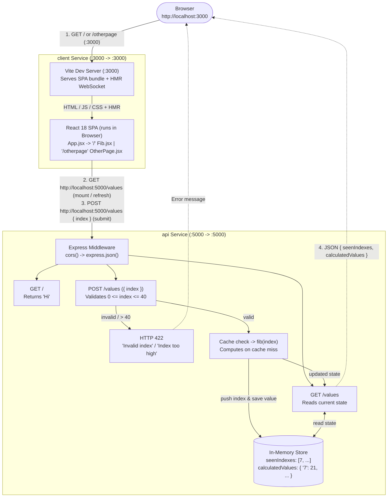
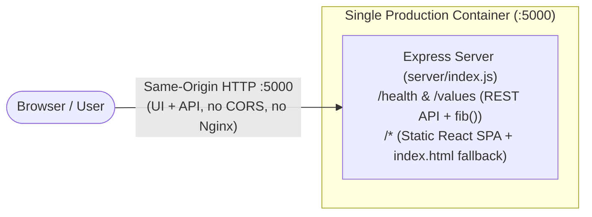
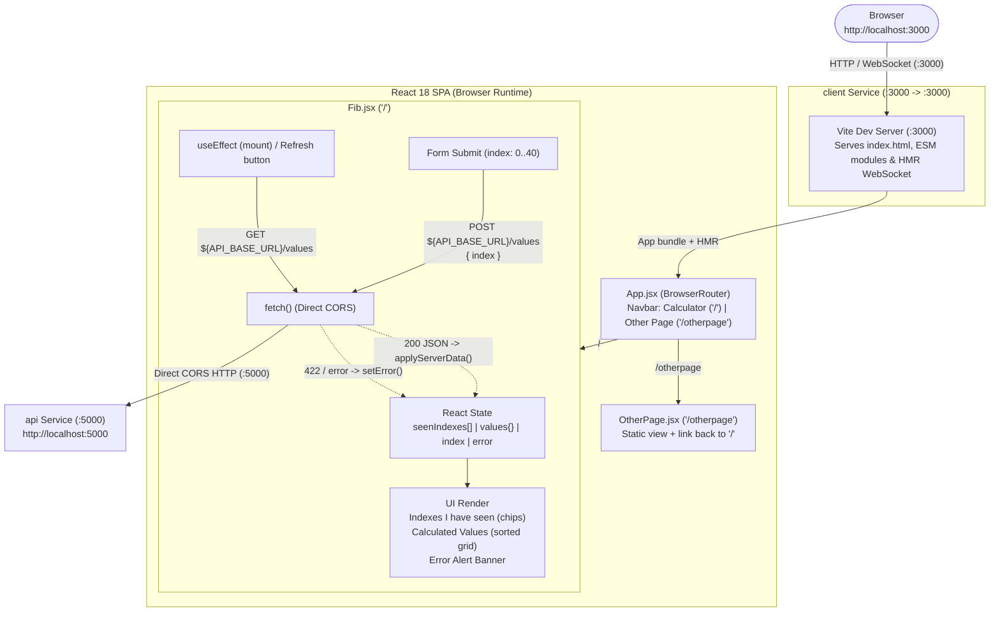
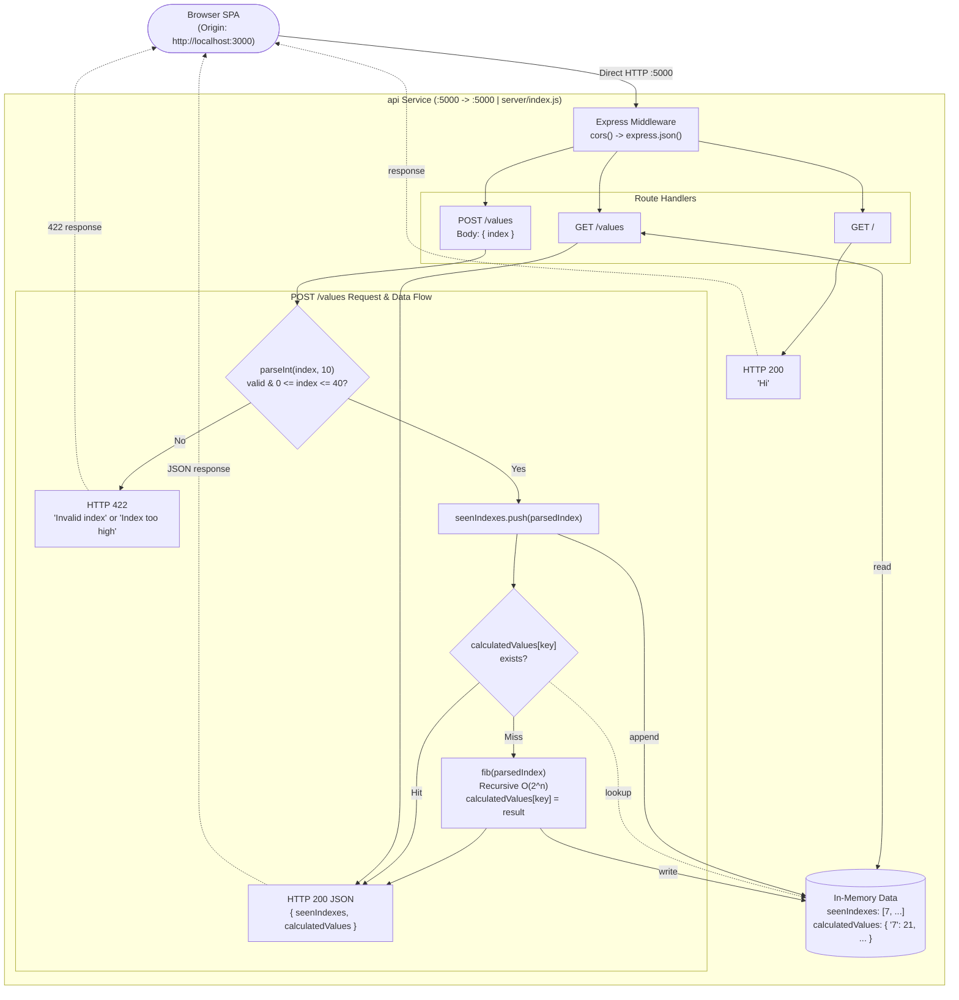

# Client-Server Local Architecture

A minimal 2-container version of the Fibonacci calculator application using only **React Client** and **Express API Server** — with no Nginx reverse proxy, PostgreSQL, Redis, or separate background worker.

- **Direct Communication (No Reverse Proxy)**: Both `client` (`:3000`) and `api` (`:5000`) expose their ports directly to the host. The browser loads the React SPA from `http://localhost:3000` and makes direct cross-origin (`CORS`) API requests to `http://localhost:5000` (configurable via `VITE_API_URL`).
- **Storage**: Uses simple in-memory JavaScript data structures (`seenIndexes` array and `calculatedValues` object) inside `server/index.js`.
- **Calculation**: The recursive `fib(index)` function runs directly inside the Express server.

> Note: Because data is stored in server memory, submitted indexes and calculated values reset when the `api` container restarts.

## Architecture

### Simple Overview


### Detailed Architecture (Request & Data Flow)



| Service | Container Role | Tech Stack | Port Mapping (Dev) |
| :--- | :--- | :--- | :--- |
| **`client`** | Single-Page Application (SPA) UI (Vite dev server in dev; compiled static assets served by Express in prod) | React 18, Vite, React Router | `3000:3000` |
| **`api`** | REST API, Fibonacci calculator, CORS handler, in-memory storage, and static SPA server (in prod) | Node.js, Express, `cors` | `5000:5000` |

### Why CORS Is Required in Development (and Not in Production)

- **Development (`docker compose up`):** The frontend runs on `http://localhost:3000` and the backend on `http://localhost:5000`. Because the ports differ, browsers treat API requests as **cross-origin**, so `app.use(cors())` in [`server/index.js`](./server/index.js) is required.
- **Production (Single Container — [`Dockerfile`](./Dockerfile)):** There is **zero Nginx**. A multi-stage build compiles the React app with `VITE_API_URL=""` into `/app/public` inside the Express container. Express serves both the API (`/health`, `/values`) and the static SPA (`express.static` + `*` fallback to `index.html`) from the **same origin** on port `5000` (or `$PORT`).



## Service Architecture Diagrams

### 1. React Client Service (`client`)

Serves the React 18 SPA directly on `:3000` and calls the Express API directly at `VITE_API_URL` (default `http://localhost:5000`).



### 2. Express API Service (`api`)

Handles direct REST requests on `:5000` ([`server/index.js`](./server/index.js)), allowing CORS, validating inputs, computing Fibonacci numbers recursively, and updating in-memory state.



## Quick Start

For full installation, testing, production build, and troubleshooting instructions, see [SETUP.md](./SETUP.md).

```bash
cd client-server-local
docker compose up --build
```

Then open [http://localhost:3000](http://localhost:3000) (API runs at [http://localhost:5000](http://localhost:5000)).

## API Endpoints

All API requests go directly to the Express server (no `/api` prefix):

- `GET /health` — Health check (`{ "status": "ok" }`)
- `GET /` — Development sanity check (`"Hi"`); in single-container production, serves the React SPA (`index.html`)
- `GET /values` — Returns `{ seenIndexes: [7, ...], calculatedValues: { "7": 21, ... } }`
- `POST /values` — Body `{ "index": "7" }`. Validates `0 <= index <= 40`, computes `fib(index)`, stores it in memory, and returns the updated `{ seenIndexes, calculatedValues }`.
