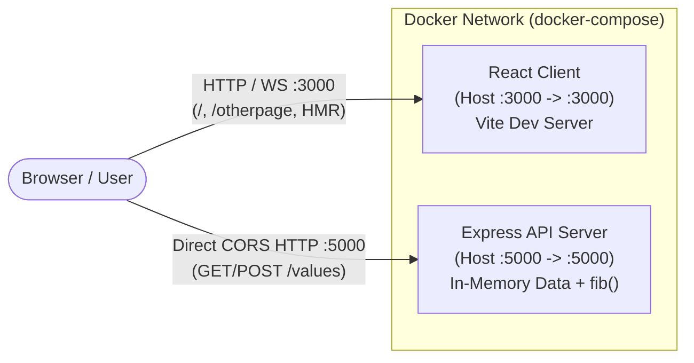

# Client-Server Local Architecture

A minimal, local-only 2-container version of the Fibonacci calculator application using only **React Client** and **Express API Server** — with no Nginx reverse proxy, PostgreSQL, Redis, or separate background worker.

- **Direct Communication (No Reverse Proxy)**: Both `client` (`:3000`) and `api` (`:5000`) expose their ports directly to the host. The browser loads the React SPA from `http://localhost:3000` and makes direct cross-origin (`CORS`) API requests to `http://localhost:5000` (configurable via `VITE_API_URL`).
- **Storage**: Uses simple in-memory JavaScript data structures (`seenIndexes` array and `calculatedValues` object) inside `server/index.js`.
- **Calculation**: The recursive `fib(index)` function runs directly inside the Express server.

> Note: Because data is stored in server memory, submitted indexes and calculated values reset when the `api` container restarts.

## Architecture

### Simple Overview



### Detailed Architecture (Request & Data Flow)


| Service | Container Role | Tech Stack | Port Mapping |
| :--- | :--- | :--- | :--- |
| **`client`** | Single-Page Application (SPA) UI (Vite dev server) | React 18, Vite, React Router | `3000:3000` |
| **`api`** | REST API, Fibonacci calculator, CORS handler, and in-memory storage | Node.js, Express, `cors` | `5000:5000` |

### Why `docker-compose.yml` Is Included

[`docker-compose.yml`](./docker-compose.yml) is kept as a **local development convenience**:

- Launches both Vite HMR (`:3000`) and Express `nodemon` (`:5000`) with a single `docker compose up --build` command.
- Requires no Node.js installation on the host machine and keeps the Node.js runtime consistent.
- Matches the dev workflow of `client-server-nginx-local` and `multi-container-services-local`.

### Why CORS Is Required Here

Unlike `client-server-nginx-local` (where Nginx serves both `/` and `/api/*` under the same origin `http://localhost:3050`), this setup serves the frontend from `http://localhost:3000` and the backend from `http://localhost:5000`. Because the ports differ, browsers treat API requests as **cross-origin**, so `app.use(cors())` in [`server/index.js`](./server/index.js) is required for `fetch()` calls to succeed.

## Quick Start

For full setup and troubleshooting instructions, see [SETUP.md](./SETUP.md).

```bash
cd client-server-local
docker compose up --build
```

Then open [http://localhost:3000](http://localhost:3000) (API runs at [http://localhost:5000](http://localhost:5000)).

## API Endpoints

All API requests go directly to the Express server on port `5000` (no `/api` prefix):

- `GET /` — Health check (`"Hi"`)
- `GET /values` — Returns `{ seenIndexes: [7, ...], calculatedValues: { "7": 21, ... } }`
- `POST /values` — Body `{ "index": "7" }`. Validates `0 <= index <= 40`, computes `fib(index)`, stores it in memory, and returns the updated `{ seenIndexes, calculatedValues }`.
