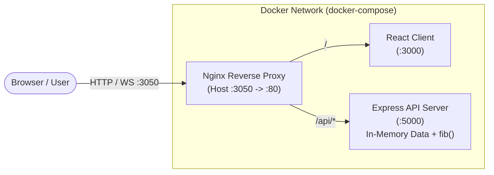

# Client-Server-Nginx Local Architecture

A simplified 3-container version of the Fibonacci calculator application using only **Nginx**, **React Client**, and **Express API Server**.

PostgreSQL, Redis, and the separate background worker service have been removed:
- **Storage**: Replaced with simple in-memory JavaScript data structures (`seenIndexes` array and `calculatedValues` object) inside `server/index.js`.
- **Calculation**: The recursive `fib(index)` worker function runs directly inside the Express server.

> Note: Because data is stored in server memory, submitted indexes and calculated values reset when the `api` container restarts.

## Architecture



| Service | Container Role | Tech Stack | Internal Port |
| :--- | :--- | :--- | :--- |
| **`nginx`** | Single entry point & HTTP/WS reverse proxy | Nginx | `80` (Host `3050`) |
| **`client`** | Single-Page Application (SPA) UI | React 18, Vite, React Router, Axios | `3000` |
| **`api`** | REST API, Fibonacci calculator, and in-memory storage | Node.js, Express | `5000` |

## Quick Start

For full installation, testing, production build, and troubleshooting instructions, see [SETUP.md](./SETUP.md).

```bash
cd client-server-nginx-local
docker compose up --build
```

Then open [http://localhost:3050](http://localhost:3050).

## API Endpoints

All API requests are routed by Nginx from `/api/*` to the Express server (stripping the `/api` prefix):

- `GET /api/` — Health check (`"Hi"`)
- `GET /api/values/all` — Returns the in-memory list of submitted indexes (`[{ number: 7 }, ...]`)
- `GET /api/values/current` — Returns the in-memory map of calculated values (`{ "7": 21, ... }`)
- `POST /api/values` — Body `{ "index": "7" }`. Validates `0 <= index <= 40`, computes `fib(index)`, and stores it in memory.
