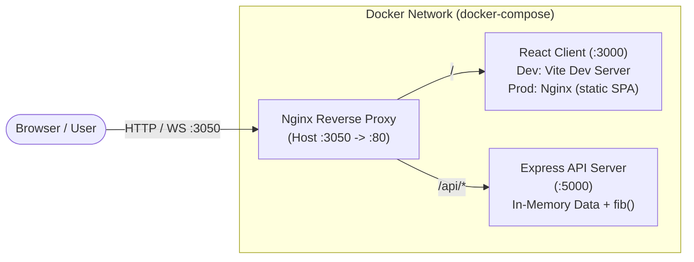

# Client-Server-Nginx Local Architecture

A simplified 3-container version of the Fibonacci calculator application using only **Nginx**, **React Client**, and **Express API Server**.

PostgreSQL, Redis, and the separate background worker service have been removed:
- **Storage**: Replaced with simple in-memory JavaScript data structures (`seenIndexes` array and `calculatedValues` object) inside `server/index.js`.
- **Calculation**: The recursive `fib(index)` worker function runs directly inside the Express server.

> Note: Because data is stored in server memory, submitted indexes and calculated values reset when the `api` container restarts.

## Architecture



| Service | Container Role | Tech Stack | Internal Port |
| :--- | :--- | :--- | :--- |
| **`nginx`** | Single entry point & HTTP/WS reverse proxy | Nginx (`nginx/default.conf`) | `80` (Host `3050`) |
| **`client`** | Single-Page Application (SPA) UI (Vite dev server in dev; Nginx serving static bundle in prod) | React 18, Vite, React Router, Axios, Nginx (prod) | `3000` |
| **`api`** | REST API, Fibonacci calculator, and in-memory storage | Node.js, Express | `5000` |

### Nginx Inside `client` (Development vs. Production)

This project has **two** separate Nginx configurations with different responsibilities:

- **Outer reverse proxy ([`nginx/default.conf`](./nginx/default.conf))**: Runs in the `nginx` container on port `80` (mapped to host `3050`) and routes `/` to `client:3000` and `/api/*` to `api:5000`.
- **Client container Nginx ([`client/nginx/default.conf`](./client/nginx/default.conf))**: Used **only in production** ([`client/Dockerfile`](./client/Dockerfile)). A multi-stage build compiles the React app with Vite into static assets (`/app/dist`), then serves them with Nginx on port `3000` (matching the outer proxy's `client:3000` upstream) using `try_files $uri $uri/ /index.html` so React Router paths like `/otherpage` work on page refresh.
- **In local development** ([`docker-compose.yml`](./docker-compose.yml) / [`client/Dockerfile.dev`](./client/Dockerfile.dev)): The `client` container does **not** run Nginx—it runs the **Vite dev server** on port `3000` for live reloading and Hot Module Replacement.

## Quick Start

For full installation, testing, production build, and troubleshooting instructions, see [SETUP.md](./SETUP.md).

```bash
cd client-server-nginx-local
docker compose up --build
```

Then open [http://localhost:3050](http://localhost:3050).

## API Endpoints

All API requests are routed by Nginx from `/api/*` to the Express server (stripping the `/api` prefix):

- `GET /api/` — Health check (`"Hi"`)
- `GET /api/values` — Returns `{ seenIndexes: [{ number: 7 }, ...], calculatedValues: { "7": 21, ... } }`
- `POST /api/values` — Body `{ "index": "7" }`. Validates `0 <= index <= 40`, computes `fib(index)`, and stores it in memory.
