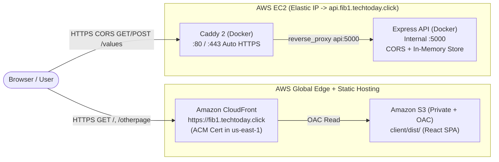

# Client-Server Prod (AWS Architecture)

Production-ready AWS deployment of the Fibonacci calculator app using a **split custom-domain architecture**:

- **Frontend (`https://fib1.techtoday.click`):** Static React + Vite SPA hosted in a private **Amazon S3** bucket and served globally over HTTPS via **Amazon CloudFront** + **AWS ACM** (`us-east-1`).
- **Backend (`https://api.fib1.techtoday.click`):** Containerized Express API running on **Amazon EC2** behind **Caddy**, which automatically provisions and renews Let's Encrypt HTTPS certificates and proxies requests to the private `api:5000` container.
- **Storage:** In-memory JavaScript structures (`seenIndexes`, `calculatedValues`) inside the single EC2 API container.

> **Note:** Because data is stored in memory, keep the backend at **1 container instance** on EC2. Submitted values reset if the `api` container restarts. For persistence or horizontal scaling, replace the in-memory store with Amazon DynamoDB or RDS + ElastiCache.

---

## Architecture



---

## Project Structure

```text
.github/workflows/
└── client-server-prod.yml     # CI/CD workflow (S3 + CloudFront frontend, EC2 + Caddy backend)

client-server-prod/
├── README.md                  # Architecture overview
├── DEPLOY.md                  # Step-by-step AWS & GitHub Actions setup guide
├── client/                    # React 18 + Vite SPA (builds to static dist/ for S3)
│   ├── .env.example           # Example VITE_API_URL for production builds
│   ├── package.json           # Includes `npm run build` for static output
│   └── src/                   # React components (Fib.jsx, OtherPage.jsx, App.jsx)
├── server/                    # Production Express API
│   ├── Dockerfile             # Non-root production Node 22 Alpine image + HEALTHCHECK
│   ├── .dockerignore
│   ├── index.js               # Env-driven PORT, CORS allowlist (CLIENT_ORIGIN), graceful shutdown
│   └── package.json           # Includes `npm start`
└── ec2/                       # EC2 production runtime stack
    ├── .env.example           # API_DOMAIN, CLIENT_ORIGIN, ACME_EMAIL
    ├── Caddyfile              # Automatic Let's Encrypt HTTPS + reverse proxy to api:5000
    └── docker-compose.prod.yml
```

---

## Key Production Differences from `client-server-local`

| Area | `client-server-local` | `client-server-prod` |
| :--- | :--- | :--- |
| **Frontend serving** | Vite dev server in Docker (`:3000`) | Static `vite build` output on **S3 + CloudFront** (`https://fib1.techtoday.click`) |
| **Backend serving** | `nodemon` in Docker (`:5000` exposed) | Production `Dockerfile` (`node index.js`, non-root) behind **Caddy** (`:443` HTTPS, `:5000` private) |
| **CORS** | Open `cors()` | Strict origin allowlist via `CLIENT_ORIGIN` |
| **HTTPS / TLS** | Local HTTP only | **ACM (`us-east-1`)** on CloudFront + **Caddy Auto-HTTPS (Let's Encrypt)** on EC2 |
| **Process lifecycle** | Dev auto-restart | `restart: unless-stopped`, Docker `HEALTHCHECK`, graceful `SIGTERM`/`SIGINT` shutdown |

---

## Deployment

See **[DEPLOY.md](./DEPLOY.md)** for the full step-by-step AWS setup (EC2 + Elastic IP + Caddy, S3 + CloudFront + ACM, DNS records, and updates).
