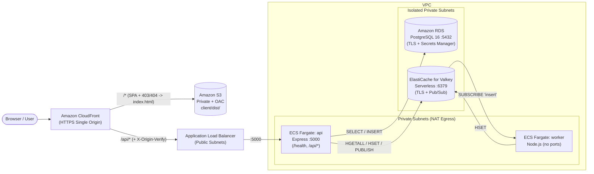

# Multi-Container Services Prod (AWS Architecture)

Production-ready AWS deployment of the multi-container Fibonacci calculator application provisioned with **AWS CDK (TypeScript)** using a **single-origin CloudFront architecture**:

- **Frontend (`/*`):** Static React 18 + Vite SPA stored in a private **Amazon S3** bucket and served over HTTPS via **Amazon CloudFront** with Origin Access Control (OAC).
- **API Routing (`/api/*`):** CloudFront forwards `/api/*` requests to an **Application Load Balancer (ALB)** in public subnets (protected by an `X-Origin-Verify` header), which routes to the private **ECS Fargate** `api` service on port `5000`.
- **Background Worker:** Separate **ECS Fargate** `worker` service in private subnets (no exposed ports) subscribed to Valkey Pub/Sub `"insert"` events to compute Fibonacci values asynchronously.
- **Managed Data Layer:** **Amazon RDS for PostgreSQL 16** (credentials injected via **AWS Secrets Manager**) and **Amazon ElastiCache for Valkey Serverless** (TLS-encrypted) in isolated private subnets.

---

## Architecture



---

## Project Structure

```text
.github/workflows/
└── multi-container-services-prod.yml   # CI/CD: build client, validate server/worker, CDK deploy via OIDC

multi-container-services-prod/
├── README.md                           # Architecture overview and differences from local
├── DEPLOY.md                           # Step-by-step CDK bootstrap, deploy, CI/CD, and teardown guide
├── client/                             # React 18 + Vite SPA (builds to static dist/ for S3 + CloudFront)
│   ├── index.html
│   ├── package.json
│   ├── vite.config.js
│   └── src/
├── server/                             # Production Express API (ECS Fargate)
│   ├── Dockerfile                      # Non-root node:22-alpine + HEALTHCHECK
│   ├── .dockerignore
│   ├── keys.js                         # Env-driven config (PORT, PGSSL, REDIS_TLS)
│   ├── index.js                        # /health, /api/* routes, TLS for RDS/Valkey, graceful SIGTERM
│   └── package.json
├── worker/                             # Production background worker (ECS Fargate)
│   ├── Dockerfile                      # Non-root node:22-alpine
│   ├── .dockerignore
│   ├── keys.js                         # Env-driven config (REDIS_TLS)
│   ├── index.js                        # TLS Valkey Pub/Sub subscriber, graceful SIGTERM
│   └── package.json
└── infra/                              # AWS CDK (TypeScript) infrastructure stack
    ├── bin/multi-container-services-prod.ts
    ├── lib/multi-container-services-prod-stack.ts
    ├── cdk.json
    ├── package.json
    └── tsconfig.json
```

---

## Key Production Differences from `multi-container-services-local`

| Area | `multi-container-services-local` | `multi-container-services-prod` |
| :--- | :--- | :--- |
| **Reverse proxy** | Local `nginx` container (`rewrite /api/(.*) /$1`) | **CloudFront + ALB** single origin; Express mounts routes natively under `/api` |
| **Frontend serving** | Vite dev server / Nginx container (`:3000`) | Static `vite build` output on **private S3 + CloudFront (OAC)** |
| **Backend & worker** | Local Docker Compose (`nodemon`) | **ECS Fargate** (`node:22-alpine`, non-root user, circuit breaker rollback, graceful `SIGTERM`) |
| **PostgreSQL** | Ephemeral `postgres` container | **Amazon RDS for PostgreSQL 16** (encrypted, automated backups, **Secrets Manager** creds, TLS) |
| **Redis** | Ephemeral `redis` container | **Amazon ElastiCache for Valkey Serverless** (TLS-encrypted, isolated subnets) |
| **Networking** | Flat Docker bridge network | 3-tier **VPC** (public ALB, private Fargate, isolated data) with least-privilege Security Groups |

---

## Deployment

See **[DEPLOY.md](./DEPLOY.md)** for prerequisites, `cdk bootstrap`, deployment commands, GitHub Actions OIDC setup, estimated monthly costs, and `cdk destroy` teardown instructions.
