# Multi-Container Services Architecture

A multi-container Fibonacci calculator web application built to demonstrate **Docker Compose orchestration**, **Nginx reverse proxy routing**, **multi-stage production builds**, **asynchronous event-driven processing via Redis Pub/Sub**, and **polyglot persistence (PostgreSQL + Redis)**.

> **Why is this intentionally over-engineered for a Fibonacci calculator?**
> Computing Fibonacci recursively (`O(2^n)`) simulates a CPU-intensive background job. Separating the web frontend, REST API, background worker, in-memory cache/broker, and relational database mirrors real-world microservice patterns.

---

## Table of Contents

1. [Overall High-Level Architecture](#1-overall-high-level-architecture)
2. [Individual Component Diagrams](#2-individual-component-diagrams)
   - [2.1 Nginx Reverse Proxy (`nginx/`)](#21-nginx-reverse-proxy-nginx)
   - [2.2 React Client Frontend (`client/`)](#22-react-client-frontend-client)
   - [2.3 Express API Server (`server/`)](#23-express-api-server-server)
   - [2.4 Background Fibonacci Worker (`worker/`)](#24-background-fibonacci-worker-worker)
   - [2.5 Data Layer (PostgreSQL & Redis)](#25-data-layer-postgresql--redis)
   - [2.6 Docker Compose & CI/CD Pipeline](#26-docker-compose--cicd-pipeline)
3. [Detailed Architecture & End-to-End Flows](#3-detailed-architecture--end-to-end-flows)
   - [3.1 Detailed System Architecture](#31-detailed-system-architecture)
   - [3.2 End-to-End Request & Event Sequence](#32-end-to-end-request--event-sequence)
4. [Quick Start & Directory Map](#4-quick-start--directory-map)

---

## 1. Overall High-Level Architecture

At a high level, a single **Nginx Reverse Proxy** acts as the sole public entry point (port `3050` on the host, mapped to port `80` inside the container). It routes browser traffic to either the **React Client** (UI assets and WebSockets) or the **Express API** (backend data endpoints). Heavy Fibonacci calculations are decoupled from HTTP request handling using **Redis Pub/Sub** and a dedicated **Worker** service, while **PostgreSQL** durably records every submitted index.

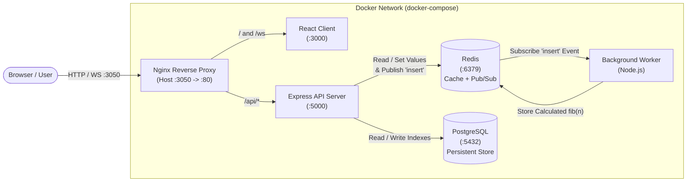

| Service | Container Role | Tech Stack | Internal Port |
| :--- | :--- | :--- | :--- |
| **`nginx`** | Single entry point & HTTP/WS reverse proxy | Nginx | `80` (Host `3050`) |
| **`client`** | Single-Page Application (SPA) UI | React 18, React Router, Axios | `3000` |
| **`api`** | REST API coordinating Postgres & Redis | Node.js, Express, `pg`, `redis` | `5000` |
| **`worker`** | Asynchronous Fibonacci calculator | Node.js, `redis` | None (event-driven) |
| **`redis`** | In-memory Hash store + Pub/Sub broker | Redis | `6379` |
| **`postgres`** | Durable SQL database of submitted indexes | PostgreSQL | `5432` |

---

## 2. Individual Component Diagrams

### 2.1 Nginx Reverse Proxy (`nginx/`)

Nginx eliminates CORS issues in production and hides internal container ports by exposing one unified origin (`http://localhost:3050`). It inspects the URL path and forwards requests to the appropriate upstream service resolved via Docker's internal DNS (`client` and `api`).

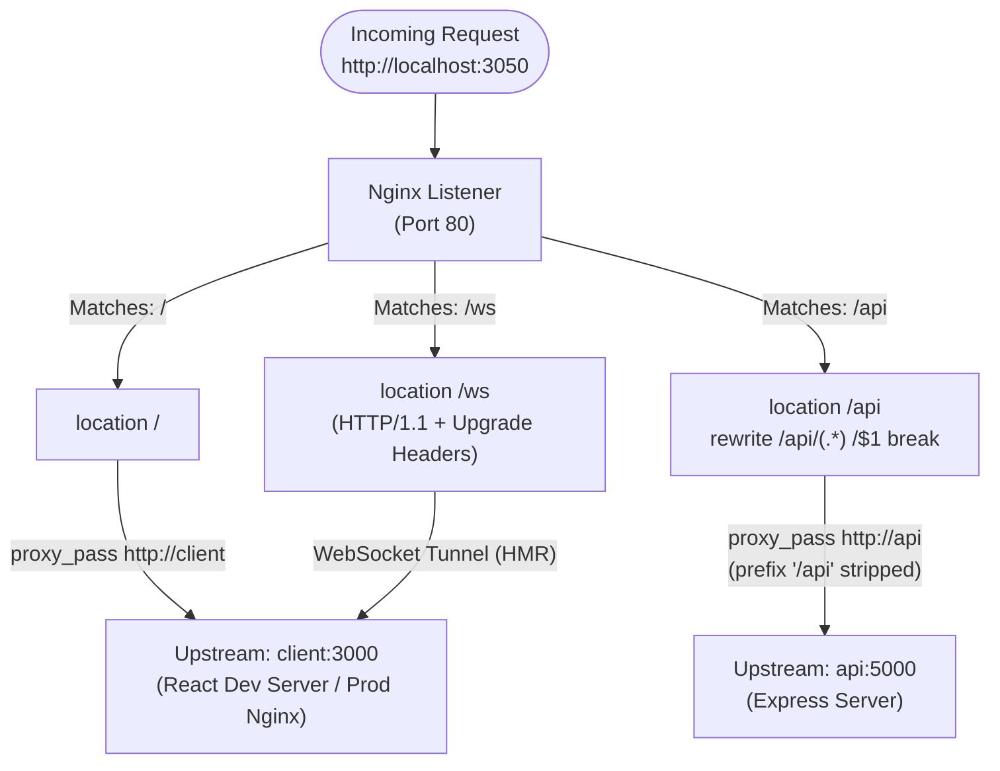

**Key Configuration Details (`nginx/default.conf`):**
- **`location /`**: Forwards UI page and static asset requests to `client:3000`.
- **`location /ws`**: Upgrades connections to WebSockets so Create React App's Webpack Dev Server can push Hot Module Replacement (HMR) updates during development.
- **`location /api`**: Strips the `/api` prefix using `rewrite /api/(.*) /$1 break;` before forwarding to `api:5000` (e.g., `/api/values/all` arrives at Express as `/values/all`).

---

### 2.2 React Client Frontend (`client/`)

The frontend is a React 18 SPA using `react-router-dom` for client-side navigation and `axios` to communicate with the backend through relative `/api/*` paths. It uses **two distinct Docker build strategies** for development vs. production.

#### Component & API Interaction

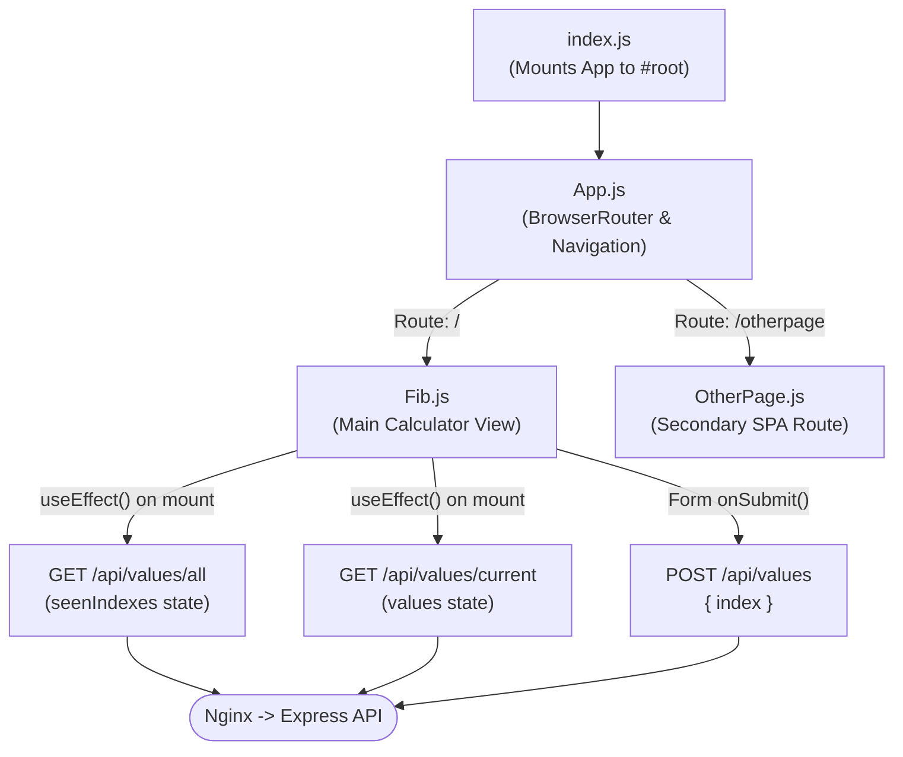

#### Development vs. Production Container Architecture

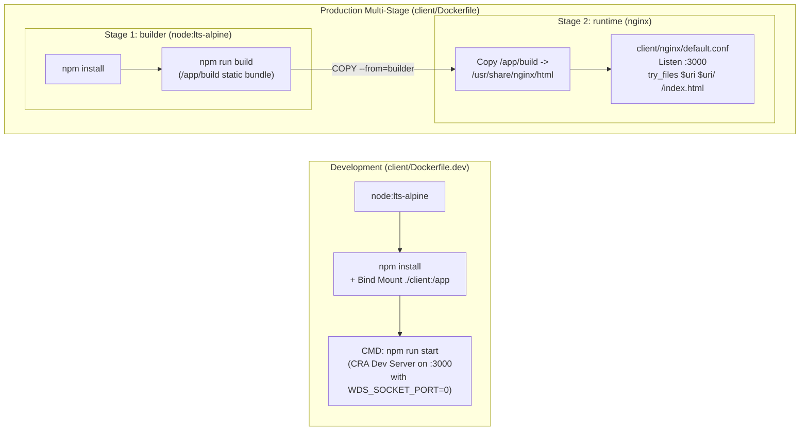

> **Why `try_files $uri $uri/ /index.html;`?**
> In production, navigating directly to `/otherpage` hits Nginx inside the `client` container. Because `/otherpage` is a React Router route (not a physical file on disk), `try_files` falls back to `index.html` so React Router can handle the path on the client.

---

### 2.3 Express API Server (`server/`)

The API server listens on port `5000` and acts as the coordinator between HTTP clients, PostgreSQL, and Redis. It never computes Fibonacci values directly; instead, it records intent and publishes an event so the HTTP request returns immediately.

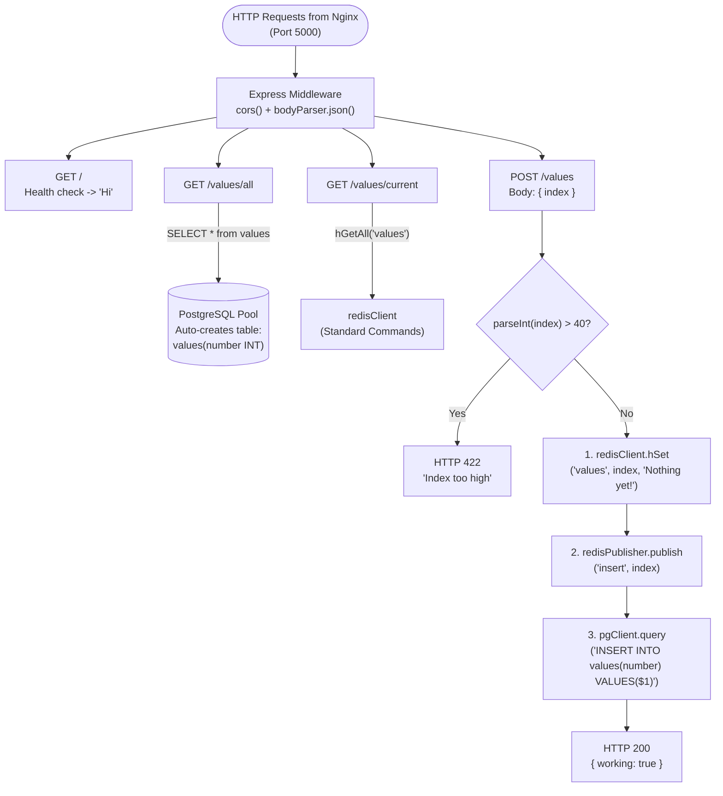

**Why two Redis connections (`redisClient` and `redisPublisher`)?**
According to the Redis client specification, a connection dedicated to Pub/Sub operations should not be mixed with standard read/write commands. Therefore, `server/index.js` creates `redisPublisher = redisClient.duplicate()`.

---

### 2.4 Background Fibonacci Worker (`worker/`)

The worker has **no HTTP server and exposes no ports**. It stays subscribed to Redis's `"insert"` channel, runs the CPU-bound recursive Fibonacci function whenever a new index arrives, and writes the computed result back to the `"values"` hash in Redis.

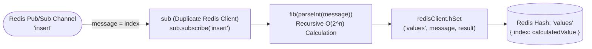

**Why cap `index <= 40` in the API?**
`worker/index.js` uses a naive recursive algorithm (`fib(n - 1) + fib(n - 2)`). Beyond index `40`, calculation time grows exponentially and would tie up the worker's single-threaded Node.js event loop for a very long time.

---

### 2.5 Data Layer (PostgreSQL & Redis)

The project intentionally splits state across two data stores based on access pattern and durability:

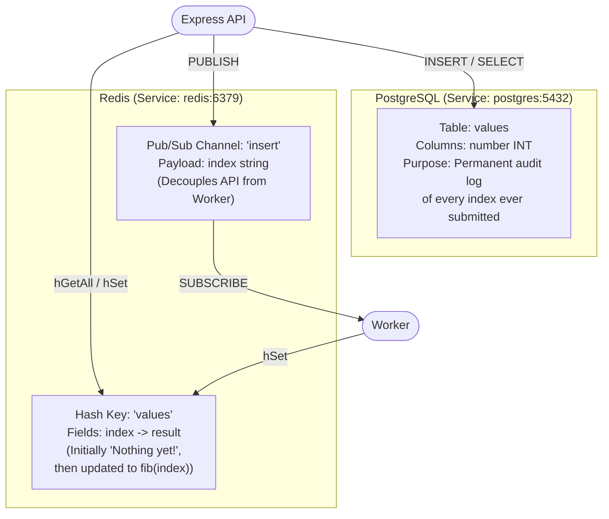

---

### 2.6 Docker Compose & CI/CD Pipeline

#### Local Development Orchestration (`docker-compose.yml`)

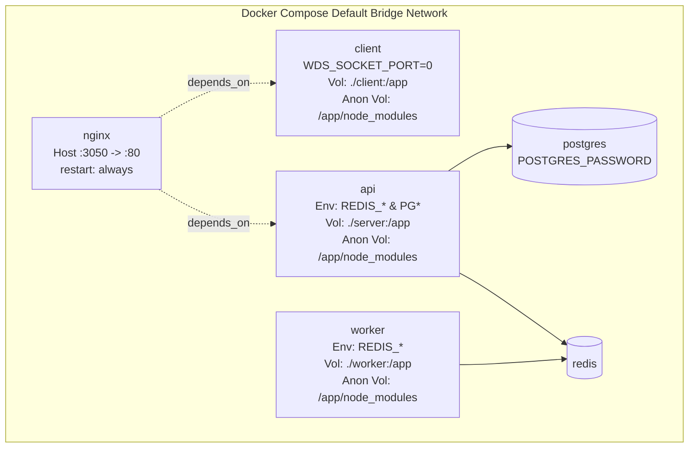

> **Why mount `/app/node_modules` as an anonymous volume?**
> Mounting `./server:/app` enables live code reloading with `nodemon`, but would otherwise overwrite the container's Linux-built `node_modules` directory with the host's folder. Declaring `- /app/node_modules` pins the container's installed dependencies inside the container.

#### CI/CD Deployment Pipeline (`.github/workflows/deploy.yaml`)

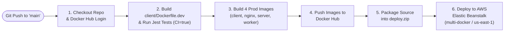

---

## 3. Detailed Architecture & End-to-End Flows

### 3.1 Detailed System Architecture

This diagram brings together all containers, ports, hostnames, volumes, environment variables, routes, and data structures in one complete blueprint.

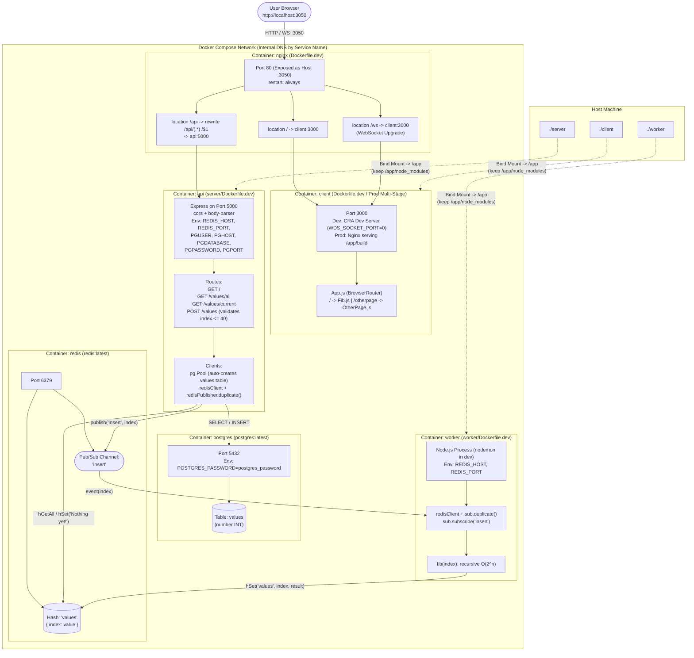

---

### 3.2 End-to-End Request & Event Sequence

The sequence below traces a complete user lifecycle: loading the app, submitting a new index (e.g., `7`), background calculation by the worker, and viewing the updated result on refresh.

```mermaid
%%{init: {'theme': 'dark', 'themeVariables': { 'darkMode': true, 'background': '#0d1117', 'primaryColor': '#1f2937', 'primaryTextColor': '#f3f4f6', 'primaryBorderColor': '#4b5563', 'lineColor': '#9ca3af', 'actorBkg': '#1e293b', 'actorBorder': '#60a5fa', 'actorTextColor': '#f8fafc', 'actorLineColor': '#64748b', 'signalColor': '#e5e7eb', 'signalTextColor': '#f3f4f6', 'labelBoxBkgColor': '#1e293b', 'labelBoxBorderColor': '#475569', 'labelTextColor': '#f8fafc', 'noteBkgColor': '#334155', 'noteTextColor': '#f8fafc', 'noteBorderColor': '#64748b' }}}%%
sequenceDiagram
    autonumber
    actor User as Browser
    participant Nginx as Nginx (:3050 -> :80)
    participant Client as React Client (:3000)
    participant API as Express API (:5000)
    participant PG as PostgreSQL (:5432)
    participant Redis as Redis (:6379)
    participant Worker as Worker (Node.js)

    rect rgb(23, 37, 64)
        Note over User,Redis: Phase 1: Initial Page Load
        User->>Nginx: GET /
        Nginx->>Client: Proxy to http://client:3000/
        Client-->>User: HTML + React JS Bundle

        par Fetch Historical Indexes
            User->>Nginx: GET /api/values/all
            Nginx->>API: Rewrite & Proxy -> GET /values/all
            API->>PG: SELECT * from values
            PG-->>API: [{ number: 5 }, ...]
            API-->>User: JSON list of seen indexes
        and Fetch Calculated Values
            User->>Nginx: GET /api/values/current
            Nginx->>API: Rewrite & Proxy -> GET /values/current
            API->>Redis: HGETALL values
            Redis-->>API: { "5": "8", ... }
            API-->>User: JSON map of index -> fib(index)
        end
    end

    rect rgb(20, 48, 36)
        Note over User,Worker: Phase 2: Submitting a New Index (e.g., index = "7")
        User->>Nginx: POST /api/values { "index": "7" }
        Nginx->>API: Rewrite & Proxy -> POST /values
        API->>API: Validate parseInt("7") <= 40
        API->>Redis: HSET values "7" "Nothing yet!"
        API->>Redis: PUBLISH insert "7"
        API->>PG: INSERT INTO values(number) VALUES(7)
        API-->>User: 200 OK { "working": true }

        Note over Redis,Worker: Asynchronous Background Calculation
        Redis-->>Worker: Pub/Sub message on "insert": "7"
        Worker->>Worker: Compute fib(7) = 21
        Worker->>Redis: HSET values "7" 21
    end

    rect rgb(54, 36, 22)
        Note over User,Redis: Phase 3: User Refreshes Page
        User->>Nginx: GET /api/values/all & GET /api/values/current
        Nginx->>API: Forward requests
        API->>PG: SELECT * from values -> includes 7
        API->>Redis: HGETALL values -> includes "7": "21"
        API-->>User: Updated indexes & "For index 7 I calculated 21"
    end
```

---

## 4. Quick Start & Directory Map

### Running Locally with Docker Compose

```bash
# Build images and start all 6 containers
docker compose up --build

# Open the application in your browser:
# http://localhost:3050
```

### Project Directory Map

```text
multi-container-services/
├── docker-compose.yml              # Local multi-container dev orchestration
├── .github/workflows/deploy.yaml   # CI/CD: test, build/push images, deploy to AWS EB
├── nginx/
│   ├── default.conf                # Reverse proxy rules (/, /ws, /api)
│   ├── Dockerfile                  # Production Nginx proxy image
│   └── Dockerfile.dev              # Development Nginx proxy image
├── client/
│   ├── Dockerfile                  # Multi-stage React build -> Nginx (:3000)
│   ├── Dockerfile.dev              # React development server image
│   ├── nginx/default.conf          # Production SPA static server config (try_files)
│   └── src/
│       ├── index.js                # React 18 root entry point
│       ├── App.js                  # Client-side router & layout
│       ├── Fib.js                  # Fibonacci form, API fetches, and results display
│       └── OtherPage.js            # Secondary route to verify SPA routing
├── server/
│   ├── Dockerfile                  # Production Express API image
│   ├── Dockerfile.dev              # Development Express API image (nodemon)
│   ├── keys.js                     # Env-var config for Redis & Postgres
│   └── index.js                    # Express routes, Postgres Pool, Redis client/publisher
└── worker/
    ├── Dockerfile                  # Production Worker image
    ├── Dockerfile.dev              # Development Worker image (nodemon)
    ├── keys.js                     # Env-var config for Redis
    └── index.js                    # Redis subscriber & recursive Fibonacci calculator
```
